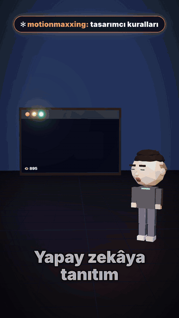
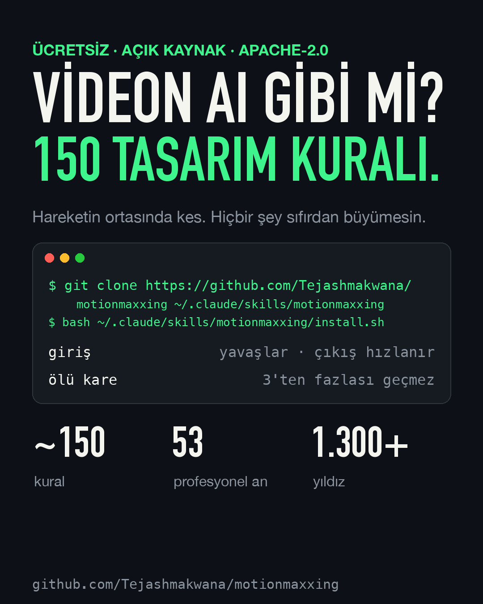

# Yapay zekâyla yaptığınız video neden izlenmiyor? Cevap ölü karelerde olabilir.

~150 tasarımcı kuralı. 53 profesyonel an, kare kare.

motionmaxxing.

Yapay zekâya tanıtım videosu yaptırdın: her şey yavaşça beliriyor, logolar sıfırdan büyüyor, geçişler hep solma, ekranda kıpırdamayan ölü kareler var.

Bu skill, Claude Code'a bir motion tasarımcısının kurallarını öğretiyor:
→ profesyoneller hareketin ortasında kesiyor, durgun anda değil
→ ekrana giren yavaşlayarak oturuyor, çıkan hızlanarak gidiyor
→ hiçbir şey sıfırdan büyümüyor
→ 3 kareden uzun ölü an kalırsa kapı videoyu geri çeviriyor
→ son kare en çok 1,4 sn bekliyor

Kurulum (Claude Code):
git clone https://github.com/Tejashmakwana/motionmaxxing ~/.claude/skills/motionmaxxing
bash ~/.claude/skills/motionmaxxing/install.sh

**📊 Rakamlarla:**
• ~150 kural
• 53 profesyonel an
• 1.300+ yıldız

**⚙️ Nasıl başlarsın:**
$ git clone https://github.com/Tejashmakwana/
    motionmaxxing ~/.claude/skills/motionmaxxing
$ bash ~/.claude/skills/motionmaxxing/install.sh

**📌 Kısa notlar:**
• giriş: yavaşlar · çıkış hızlanır
• ölü kare: 3'ten fazlası geçmez

**✨ Öne çıkanlar:**
• hareketin ortasında kes
• hiçbir şey sıfırdan büyümesin
• 3 kareden uzun ölü an = geri

Sizin videolarınızdaki en büyük "yapay zekâ işi" izi ne: solma mı, ölü kare mi?

[▶ Tam kalite video: video.mp4](video.mp4)

## Videoda adım adım

1. Adı motionmaxxing, Claude Code için ücretsiz bir skill ve 150 tasarımcı kuralıyla geliyor.
2. Kurallar 53 profesyonel anın kare kare incelenmesinden çıkarılmış.
3. Profesyoneller hareketin ortasında kesiyor, durgun anda değil.
4. Ekrana giren şey yavaşlayarak oturuyor, çıkan şey hızlanarak gidiyor.
5. Hiçbir şey sıfırdan büyümüyor ve 3 kareden uzun ölü an kalırsa kapı videoyu geri çeviriyor.
6. Kurulum iki satır, repoyu skill klasörüne kopyalayıp kurulum betiğini çalıştırıyorsun.
7. Node 22+, Python, ffmpeg ve Chrome gerekiyor, ses için isteğe bağlı ücretli bir anahtar var.
8. Dikkat, geliştirici bunun erken bir sürüm olduğunu ve geniş bir test görmediğini yazıyor.

## Kaynak

- https://github.com/Tejashmakwana/motionmaxxing

## Lisans

Bu depodaki video, kart ve metinler MIT lisanslıdır (LICENSE). Anlatılan aracın kendi lisansı kendi deposundadır.
